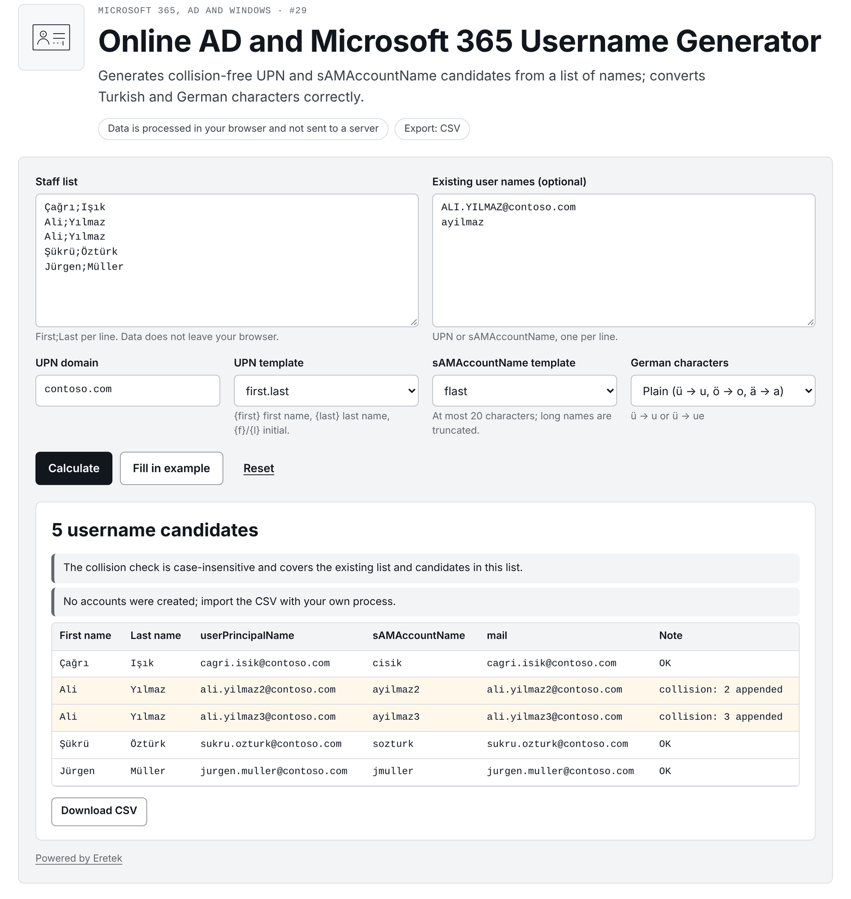

# AD and Microsoft 365 Username Generator

Generate UPN and sAMAccountName candidates from a staff list: Turkish/German character conversion, case-insensitive collision check, numbering and CSV export.

## Try it live

- [Türkçe](https://sistem.eretek.com/araclar/kullanici-adi-uretici)
- [English](https://sistem.eretek.com/en/tools/username-generator)
- [Deutsch](https://sistem.eretek.com/de/werkzeuge/benutzernamen-generator)



## What it does

Generates collision-free UPN and sAMAccountName candidates from a list of names; converts Turkish and German characters correctly.

In bulk onboarding the most frequent errors are badly converted characters (İ → i̇, ı → ?), collisions with existing accounts missed because of letter case, and two people with the same name silently getting the same account. The tool converts names safely to ASCII, compares case-insensitively with the existing list and its own candidates, and numbers collisions.

## Where it helps

Import the userPrincipalName and sAMAccountName columns into `New-ADUser` or the Microsoft 365 bulk add template. Refresh the existing list right before bulk creation.

For users whose name changes, use the UPN and SMTP Address Change Planner.

## How to use it

1. Enter staff as `First;Last` per line (tab or comma also work). Only the first word of the first name is used.
2. Paste existing UPNs or sAMAccountNames into the second field (e.g. `Get-ADUser -Filter * | select -expand SamAccountName`).
3. Choose domain and templates, press Calculate and download the CSV.

### Fields

| Field | Description |
|---|---|
| Staff list | First;Last per line. Data does not leave your browser. |
| Existing user names (optional) | UPN or sAMAccountName, one per line. |
| UPN domain |  |
| UPN template | {first} first name, {last} last name, {f}/{l} initial. |
| sAMAccountName template | At most 20 characters; long names are truncated. |
| German characters | ü → u or ü → ue |

## Example input

Press **Fill in example** in the tool to load this input.

| Input | Value |
|---|---|
| UPN domain | `contoso.com` |
| UPN template | `first.last` |
| sAMAccountName template | `flast` |
| German characters | `Plain (ü → u, ö → o, ä → a)` |

**Staff list**

```text
Çağrı;Işık
Ali;Yılmaz
Ali;Yılmaz
Şükrü;Öztürk
Jürgen;Müller
```

**Existing user names (optional)**

```text
ALI.YILMAZ@contoso.com
ayilmaz
```

**Expected result:** cagri.isik, ali.yilmaz2 and ali.yilmaz3 (ali.yilmaz exists), sukru.ozturk, jurgen.muller; sAM: cisik, ayilmaz2 …

## Method and assumptions

Conversion: Turkish ç ğ ı İ ö ş ü → c g i i o s u (İ and I are lower-cased with Turkish rules). German ä ö ü ß become a o u ss or ae oe ue ss depending on the option. Other accents are stripped; anything but letters and digits is removed.

Comparison is case-insensitive, and the part before @ of the UPN and the sAMAccountName share one pool. Collisions get 2, 3… appended. sAMAccountName is limited to 20 characters.

## Limits and common mistakes

- It does not connect to AD or Entra; it only compares with the list you enter.
- Collisions with proxyAddresses or deleted objects (recycle bin) are not visible.

## Run it locally

The tool is plain HTML, CSS and JavaScript with no build step and no dependencies.

```bash
git clone https://github.com/eretek/username-generator.git
cd username-generator
node scripts/serve.js        # or: python3 -m http.server 8080
```

Open <http://127.0.0.1:8080/>. Add `?lang=tr` or `?lang=de` for Turkish or German; without it the page follows the browser language and falls back to English. You can also open `index.html` directly from disk.

Run the tests (Node.js 18 or later):

```bash
node test/run.js    # or: npm test
```

The tests run the tool's own fixtures and the worked examples in all three languages without a browser.

## How it works

All processing happens in your browser. The tool makes no network requests, uses no cookies or browser storage, and does not upload files you select.

No server-side component is needed. The version on the Eretek website renders the same page through a private WordPress plugin; that plugin only produces the page markup and is not part of this repository.

| Path | Purpose |
|---|---|
| `index.html` | Page shell |
| `src/app.js` | Builds the page in Turkish, English or German from `src/data.js` |
| `src/data.js` | Field definitions, examples and all texts in three languages |
| `src/core.js` | Shared runtime: validation, number formats, result rendering, CSV/ICS export |
| `src/tool.js` | The calculation or analysis for this tool |
| `docs/screenshot.png` | Screenshot used in this README |
| `src/tools.css`, `src/page.css` | Styles |
| `test/run.js`, `test/cases.json` | Headless tests |

## License and attribution

This tool is released under the [Eretek Website Attribution License](LICENSE). You may use, modify and redistribute it, including commercially. If you make it available on a website or web application, show a visible, clickable credit linking to https://eretek.com/ on every page where the tool is available, for example:

```html
<a href="https://eretek.com/">Powered by Eretek</a>
```

You may add `rel="nofollow"` to the link. Keep the copyright notice and license text in copies and redistributions.
